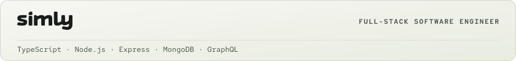
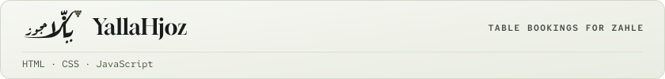
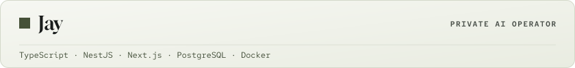
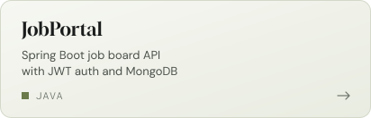
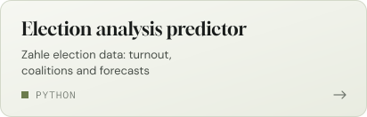
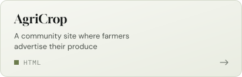

  <picture>
    <source media="(prefers-color-scheme: dark)" srcset="./assets/header-dark.svg" />
    
  </picture>

  
  
  

I'm Joseph. I write full-stack TypeScript at Simly, study Computer & Communications Engineering at Antonine University, and build a couple of products on the side. Most of that work lives in private repositories, so this page is the summary.

<h2>
  <picture>
    <source media="(prefers-color-scheme: dark)" srcset="./assets/cards/heading-working-on-dark.svg" />
    
  </picture>
</h2>

<picture>
  <source media="(prefers-color-scheme: dark)" srcset="./assets/cards/project-simly-dark.svg" />
  
</picture>

[Simly](https://www.simly.io/) is an eSIM marketplace with 3M+ users. I mostly build the internal tools its support and finance teams use, and I've started on Simly Concierge, a travel assistant.

- Built a CDR pipeline across all five eSIM providers (1Global, Telna, Bondio, Truphone, eSIM Go). It replaced manual imports and feeds usage, margin and heatmap analytics into Simly Desk.
- Led the rebuild of Simly Care, the customer care system: tickets, the provider relay and eSIM monitoring.
- Built Financial Advisor in Simly Desk, which tracks data usage, cost and user sessions from CDRs.
- Synced WhatsApp support chats from Rasayel into Simly's systems with webhooks and GraphQL.

 

<picture>
  <source media="(prefers-color-scheme: dark)" srcset="./assets/cards/project-yallahjoz-dark.svg" />
  
</picture>

YallaHjoz ("let's book") is table reservations for restaurants in Zahle. Most of them still take bookings by phone or WhatsApp and write them in a notebook, and none of the booking apps we checked list the city.

- Every booking gets a QR code that the restaurant scans at the door.
- I built a working demo of the host stand: a phone web app for the door with tonight's list, check-ins, seated guests and no-shows.
- We designed the brand ourselves, from the Arabic calligraphy logo to the app icons.

 

<picture>
  <source media="(prefers-color-scheme: dark)" srcset="./assets/cards/project-jay-dark.svg" />
  
</picture>

Jay is a single-user AI operator: one conversation for personal, business, creative and investment work. It's a TypeScript monorepo with a NestJS API, a Next.js app and Postgres with pgvector.

- Bookings, orders and anything destructive always ask for approval first, and every action goes into an append-only log.
- Memory is scoped to personal, business and investments, so one context can't leak into another.
- Background jobs on a Postgres queue flag what needs attention, grouped and rate-limited so they don't turn into noise.

<h2>
  <picture>
    <source media="(prefers-color-scheme: dark)" srcset="./assets/cards/heading-earlier-dark.svg" />
    
  </picture>
</h2>

From my first account, [Systemizable](https://github.com/Systemizable).

  <a href="https://github.com/Systemizable/JobPortal">
    <picture>
      <source media="(prefers-color-scheme: dark)" srcset="./assets/cards/earlier-jobportal-dark.svg" />
      
    </picture>
  </a>
  <a href="https://github.com/Systemizable/election-analysis-predictor">
    <picture>
      <source media="(prefers-color-scheme: dark)" srcset="./assets/cards/earlier-election-dark.svg" />
      
    </picture>
  </a>
  <a href="https://github.com/Systemizable/SAA-Sports-Analysis-App">
    <picture>
      <source media="(prefers-color-scheme: dark)" srcset="./assets/cards/earlier-sports-dark.svg" />
      
    </picture>
  </a>
  <a href="https://github.com/Systemizable/agricrop">
    <picture>
      <source media="(prefers-color-scheme: dark)" srcset="./assets/cards/earlier-agricrop-dark.svg" />
      
    </picture>
  </a>

<b>Education and a bit more about me</b>

 

- **Antonine University** · BE in Computer & Communications Engineering, Software Engineering track
- **Debate club founder** · Started my school's first official debate club. It's still running under a new student team.
- **Model United Nations** · Delegate on the UNEP committee, then advisor to five new delegates. Two won Best Position Paper and two won Diplomacy Awards.
- **Certificates** · Cisco Networking Academy (Networks, Routing & Switching, Scaling Networks, Cybersecurity, IoT, Data Science) and DataCamp AI Fundamentals
- **Languages** · Arabic, English, French, and some Spanish

 

  <picture>
    <source media="(prefers-color-scheme: dark)" srcset="./assets/cards/footer-dark.svg" />
    
  </picture>

